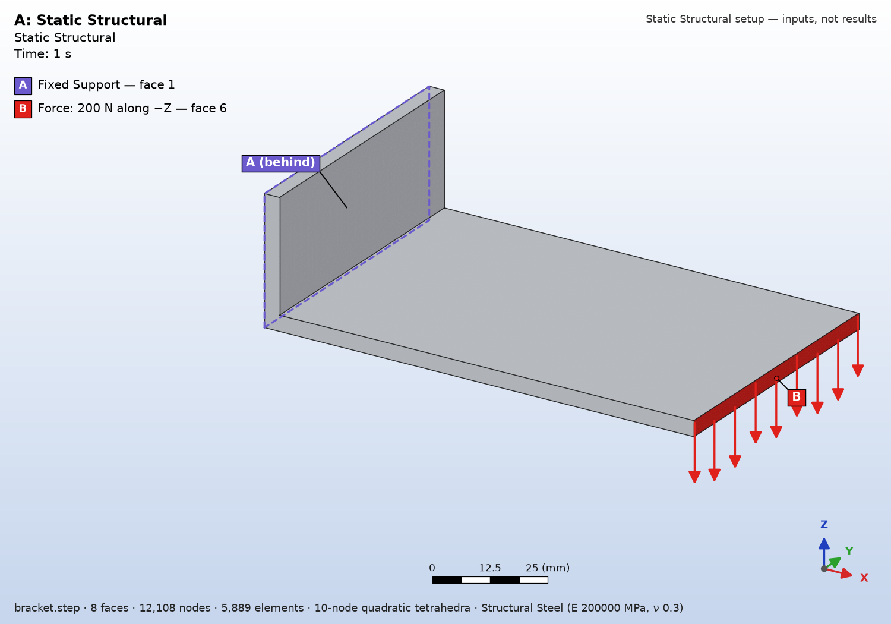
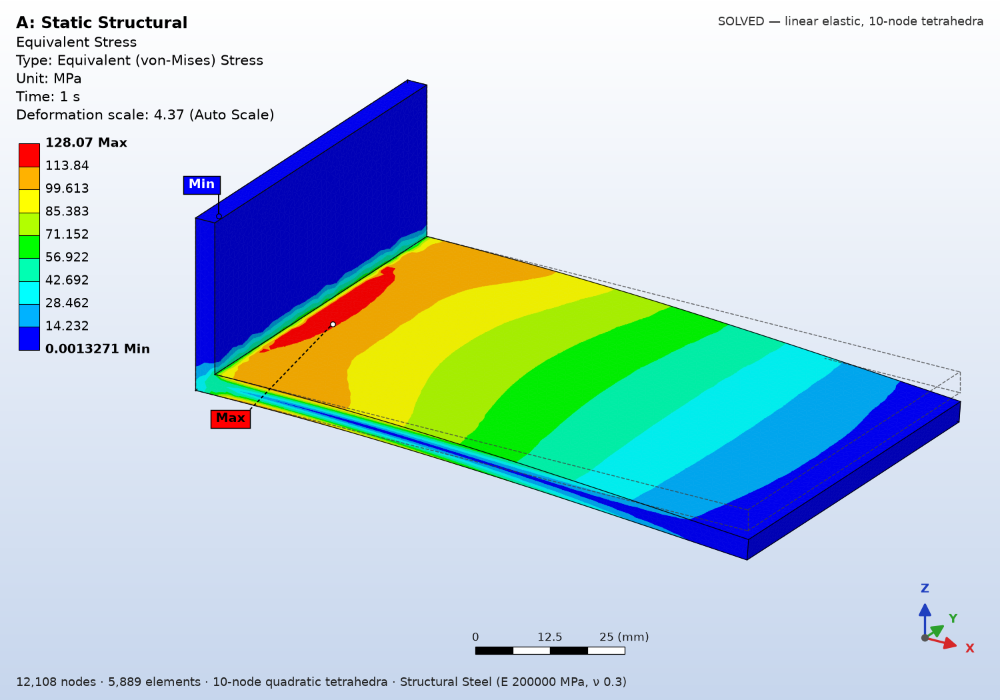
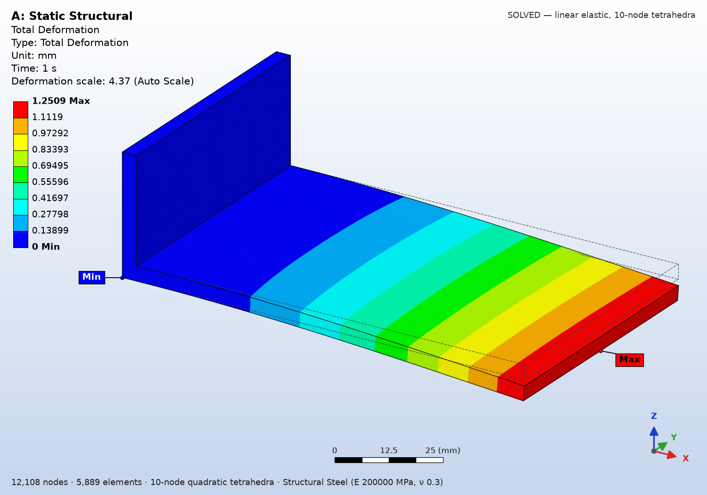

# fea-surrogate

Static structural analysis of a CAD part from the terminal, drawn the way Ansys
Mechanical draws it, plus a graph-neural-network surrogate that screens the
part in about a second when the load case is one it was trained on, and says
plainly when it is not.

| Input: where it is held and loaded | Equivalent (von-Mises) stress | Total deformation |
| --- | --- | --- |
|  |  |  |

A steel L-bracket held on the back of its wall, 200 N down on the shelf tip.
The solve gives 128 MPa at the shelf root, against 127 MPa from beam theory,
and 1.25 mm at the tip, against 1.26 mm from plate theory. Reactions balance
the applied load to 1e-8 %. This is the bracket family's trained load case, so
the surrogate also speaks. Its 90% interval for its own quantity, a
volume-averaged stress, is 33 to 63 MPa, and the solver its labels came from
gives 41.7 MPa, inside it.

## Run it

```
uv venv --python 3.12
uv pip install -e ".[solve]"        # mesh, solve, draw; no torch needed
fea-structural demo                  # builds a demo L-bracket and solves it
fea-structural part.step             # interactive: face table, then supports, loads, material
```

The interactive run prints every face of the part with a number, its area,
centre and outward normal, and draws a picture with the numbers on it. It then
asks, the way a pre-processor does, which faces are fixed, where the forces
act and how big they are, the material, and whether gravity matters. The same
case can be given as flags or as a JSON file:

```
fea-structural part.step --fixed 1 --force "6:200:-z" --material steel --yes
fea-structural part.step --fixed 1 --force "6:0,0,-150" --pressure "7:0.05" --gravity --yes
fea-structural part.step --case case.json
```

Forces are total newtons spread over the named faces, given as a magnitude and
direction (`500 N -z`, `2 kN normal`) or as components. Pressures act normal to
the surface in MPa, positive into it. Materials come from a preset table
(structural steel, aluminium alloy, stainless, titanium, copper, cast iron,
magnesium, polyethylene) or as a custom E and Poisson ratio.

Each run writes to `fea_results/<part>-<time>/`:

- **Images.** The numbered faces, the setup picture, Equivalent Stress and
  Total Deformation on the deformed shape with an undeformed wireframe.
- **Data.** `results.json` with every number, a ParaView `results.vtu`, the
  case as solved for re-running, and a summary table.

## What it does

- **Reads real CAD.** STEP, IGES or BREP. Assemblies are refused by name, and
  so are Parasolid and native CAD formats, which OpenCASCADE cannot read.
- **Solves with 10-node tetrahedra**, the quadratic element Ansys uses by
  default, through a vectorised numpy/scipy solver. It handles fixed supports,
  any number of forces and normal pressures, and gravity. Reactions are checked
  against the applied load on every run.
- **Reports stress the way Ansys does, and says where not to trust it.** The
  headline is the averaged nodal maximum. When that maximum sits on the edge of
  a fixed support or a sharp re-entrant corner, it is flagged as a singularity
  that rises with mesh refinement, and the maximum away from those features is
  reported beside it. The yield check uses that value, and says so.
- **Screens with a surrogate, honestly.** A graph neural network trained on
  3,000 finite-element solves across six part families gives a calibrated 90%
  interval in about a second. It cannot tell load directions or Poisson ratios
  apart and is not scale-invariant, all measured, so a strict gate lets it
  speak only on a family's own trained load case and size range. Anything else
  is reported as not screenable, with the reasons, and the solve answers.
- **Plugs into an agent.** The same core is served over MCP as
  `structural_solve`, next to the screening tools, so an AI CAD agent and the
  terminal can never answer the same case differently.

## Validation

| Case | Quantity | Closed form | 10-node FEA | 4-node, same mesh |
| --- | --- | --- | --- | --- |
| Cantilever 100 x 10 x 10 mm, 1 kN | tip deflection | 2.000 mm | 2.003 mm (+0.2%) | 1.307 mm (-35%) |
| Sample bracket shelf, 200 N | stress at the shelf root | 127 MPa | 128 MPa | |
| Sample bracket shelf, 200 N | tip deflection | 1.26 mm | 1.25 mm | |

The 4-node column is why the analysis uses quadratic elements. The surrogate's
training labels come from a 4-node solver, which is fine for a screening target
but reads a thin shelf's deflection and bending stress far too low. The two
paths are kept apart: the surrogate is only ever compared with the solver its
labels came from.

Against SolidWorks Simulation, on a stainless T-bracket exported from
SolidWorks (AISI 316, back face fixed, 200 N down on the shelf end, the same
1.82 mm element size in both):

| Quantity | SolidWorks | fea-structural |
| --- | --- | --- |
| Tip deflection | 1.439 mm | 1.435 mm (-0.3%) |
| Peak von-Mises stress, sharp shelf-wall corner | 146.8 MPa | 141.7 MPa, flagged singular |
| Hot-spot stress at that corner | | 130 MPa (beam theory: 133 MPa) |
| Reaction | 200.03 N | 200.00 N |

Both peaks sit on a sharp re-entrant corner, where the stress has no finite
value and rises as the mesh is refined (128 to 140 MPa here, going from
3.5 mm to 1.8 mm elements). That is why the run reports the hot-spot value
beside the peak.

## Surrogate coverage

Coverage measured on the path a user takes: fresh parts exported to STEP,
screened, then solved. The target is 0.90.

| Family | Coverage | n |
| --- | --- | --- |
| flange | 0.97 | 100 |
| pulley | 0.94 | 100 |
| stepped shaft | 0.93 | 100 |
| welded T | 0.90 | 100 |
| bracket | 0.82 | 100 |
| **overall** | **0.912** | **500** |

- **Interval width.** The shipped model's interval spans a factor of 1.28 to
  1.75 either side, depending on family. My first version, trained on the
  public SFEM dataset, needed a factor of 19.75.
- **Bracket.** Bracket sits below target on two independent runs and is still
  open.
- **Spring.** Springs are refused. The training geometry carried a defect that
  real CAD does not have, and fixing it needs a re-sweep and retrain.
- **How it got here.** The first real-use measurement was 0.415. The story of
  finding and fixing that is in
  [docs/DEPLOYED_COVERAGE.md](docs/DEPLOYED_COVERAGE.md).

## Development

```
uv pip install -e ".[inference,render]" pytest
uv run pytest tests -q
```

Trained weights are not in the repository. Generate the dataset with
`fea_surrogate.generate.sweep` and train with `notebooks/train_sweep.ipynb`.
Then point `FEA_SURROGATE_WEIGHTS` and `FEA_SURROGATE_CALIBRATION` at the
results, or put them in `models/`, and `fea-structural` will screen with them.
`fea-surrogate-mcp` serves the same tools over MCP.

## Design principles

A screening estimate is triage, not evidence. Every prediction is a
calibrated interval with declared coverage, and every document declares the
training domain it was fitted on, so the consumer can refuse a query outside
it. That refusal happens on the consumer's side: `screen_step` itself still
returns an interval for, say, a Poisson ratio outside 0.27 to 0.42. Nothing it
emits gates anything in the consuming design session. It emits
`SurrogateScreening/v1` documents consumed by `design_screening_record` in
CAD Agent.

## The flow

1. **`surrogate_inspect_cad`** reads the part and lists its faces — area,
   centroid, normal, planar or curved — with a proposed load case and what
   still has to be answered. "Planar" comes from the CAD surface type, so a
   flat face stored as a B-spline is listed as curved. BREP, STEP and IGES;
   Parasolid and native CAD formats need a licensed kernel OpenCASCADE does
   not have, and are refused by name rather than failing inside the mesher.
2. **State the load case**: which faces are held, what pushes where and how
   hard, the material. A proposal is recorded as an assumption until it is
   confirmed, because holding the wrong face screens a different question
   and the answer looks perfectly healthy.
3. **`surrogate_screen`** returns the interval, the parts it resembles with
   their solved stresses rescaled to this load, and everything it assumed.
4. **`surrogate_solve`** runs the solver that made the training labels on the
   part and returns its field as a contour. That solver is a hand-written
   numpy/scipy solver on linear (constant-strain, P1) tetrahedra in
   `generate/solver.py`. On the sample 11,229-node bracket a solve takes about
   4 s end to end, about 1 s of it meshing. Screening the same STEP takes
   about 1 s end to end, and most of that is meshing too: the model call
   itself is about 60 ms. Screening is triage that aims a check at the right
   candidate, and this is the check. It is not an estimate, so it is not
   dressed as one: it has its own schema, its own attestation, and a stamp
   reading SOLVED rather than ESTIMATE. It is also not a converged analysis.
   Constant-strain tetrahedra are stiff in bending. On that bracket's thin
   shelf they read the bending stress at about half of beam theory.

Every solve also screens the same part and records whether the interval
contained the solved answer, so each one is a coverage datapoint on a part
someone actually cared about. No synthetic sweep can produce those.

`critical_distance_mpa` is the quantity the surrogate was trained on, so it
is the number to hold an interval against. It is a volume average of von
Mises stress around the hottest element, over a radius of the part's thinnest
dimension. It is not a design stress. In bending it averages across the
section and reads well under the surface stress. On a 200×40×10 mm
cantilever it is about 115 to 127 MPa against a closed-form 300 MPa at the
root. The element peak is a different number with a different problem. It is
singular only where the
elastic solution is: at re-entrant corners and along the edges of a clamped
face. There, refining the mesh keeps raising it, so it describes the mesh
rather than the part. On a P1 L-bracket, halving the element size raised the
peak at the inside corner from 118 to 180 MPa, while the critical-distance
value moved from 51 to 53 MPa. Away from such features the peak converges. On
the cantilever the P1 peak sits at the clamped root and lands within a few
percent of the closed form. That agreement is P1's bending stiffness offsetting
a weak clamp singularity, not convergence. Quadratic elements show the root
value still rising under refinement. The contour's second panel shows each
nodal value as a multiple of the critical-distance value. Regions far above 1 are where the peak may be
reading a singularity.

Naming a family earns that family's calibration band. It does not make an
arbitrary load case belong to that family. Whenever the caller supplies its
own held and loaded faces under a family name, the document says in its
limitations that coverage is not established for that load pattern. It does
not check whether those faces happen to match the family's preset. With no
family named, the widest band is used.

Gravity is arithmetic, not screening: density times volume times g, weighed
against the applied load. Under 5% it proceeds as a stated assumption; above
it is refused, because the training set contains no body loads at all. Two
simultaneous load sets are refused too — fields superpose in linear
elasticity, but the screened quantity is a critical-distance maximum, and the
maximum of a sum is not the sum of the maxima.

## Coverage on the path a user takes

A band measured on held-out samples is a claim about the sweep, not about a
STEP file someone hands you. [docs/DEPLOYED_COVERAGE.md](docs/DEPLOYED_COVERAGE.md)
measures the second thing, and the first time it ran the answer was 0.415
against a calibrated 0.90. Run `python -m tools.deployed_coverage 100 6` from
the repository root after any change to boundary-condition selection, the
features, the mesher or the model. It loads `models/sweep_gnn.pt` and
`models/calibration.json` from that root, not from the `FEA_SURROGATE_*`
variables.

`spring` is currently refused: the shipped weights were fitted on spring
geometry carrying a duplicated end face that real CAD does not have.

## Licences

- Training data: the shipped model (`sweep/v2`) is trained on this
  repository's own 3,000-sample sweep, generated by
  `fea_surrogate.generate.sweep`. `cmudrc/SFEM` (MIT) was the first version's
  (`sfem/v1`) baseline data, not the shipped model's. It comes from Ezemba,
  McComb & Tucker, *Neural Network Surrogate Modeling for Stochastic FEM using
  3D Graph Representations*, J. Mech. Des., 2025.
- The checking solver is the hand-written numpy/scipy solver in
  `generate/solver.py`. FEniCSx is not used.
- Gmsh (GPL) is a Python dependency in the `inference` extra. It is imported
  in-process through its Python API, not run as an external tool.
- SimJEB/DeepJEB are benchmarks only; their CAD is non-commercial and is
  never redistributed here.
